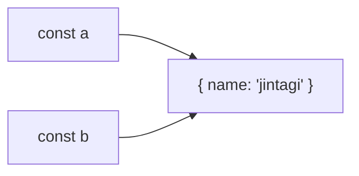
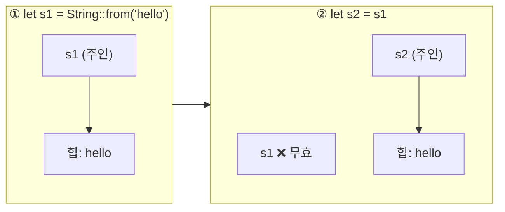
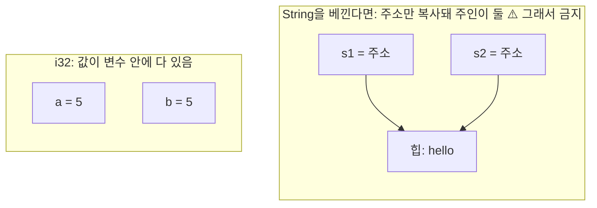
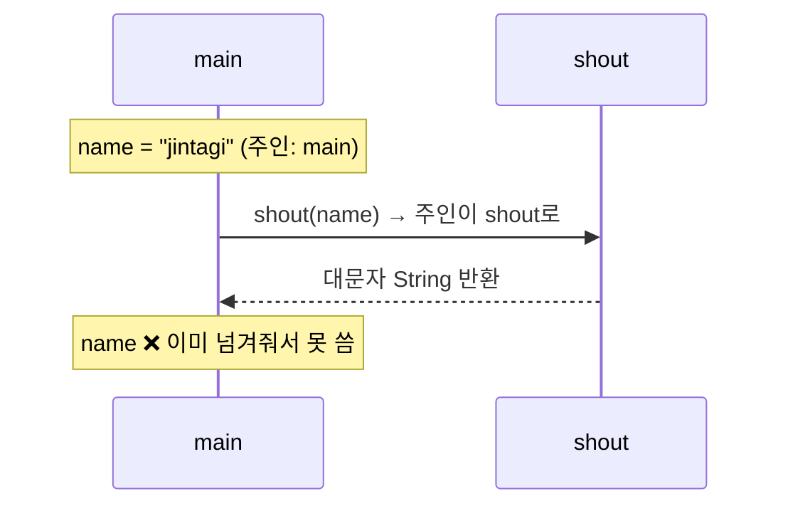

# Lesson 1 · Ownership: 값의 주인은 한 명

⏱ 약 15분 · 🎯 `let b = a;` 한 줄이 TS와 Rust에서 왜 다른 뜻인지 말로 설명하고, `E0382` 에러를 직접 만들고 직접 고친다.

---

## 0. 이 레슨에서 처음 보는 문법

읽다가 막히면 여기로 돌아오세요.

| Rust | 뜻 | TS로 치면 |
|---|---|---|
| `let a = 5;` | 변수 선언. 기본은 **수정 불가** | `const a = 5;` |
| `let a: i32 = 5;` | `: i32`는 타입 표기. `i32` = 32비트 정수 | `let a: number = 5;` |
| `String::from("hi")` | 힙에 문자열을 만드는 함수. `::`는 "타입에 붙은 함수" | `Array.from(...)` 같은 static 메서드 |
| `"hi"` | 프로그램에 박힌 고정 문자열(`&str`). `String`과 다른 타입 | (TS엔 구분 없음) |
| `fn f(x: String) -> String { ... }` | 함수. 파라미터 타입과 반환 타입 표기 | `function f(x: string): string { ... }` |
| `println!("{a}")` | 출력. `{a}` 자리에 변수 값 | `` console.log(`${a}`) `` |
| `(1, String::from("hi"))` | 튜플. `t.0`, `t.1`로 꺼냄 | `[1, "hi"]` (`[number, string]`) |

숫자 타입 전체 목록은 [치트시트](../reference/ownership.md)에.

---

## 1. 네가 이미 아는 것: TS는 "같이 가리키기"



- `const b = a;` 하면 객체는 **하나**, 가리키는 화살표만 둘.
- 누가 "주인"인지 아무도 신경 안 쓴다.
- 화살표가 전부 사라지면 GC(가비지 컬렉터)가 언젠가 치운다.

```ts
const a = { name: "jintagi" };
const b = a;
b.name = "ferris";
console.log(a.name); // "ferris" ← 같은 객체니까
```

---

## 2. Rust엔 GC가 없다 → 규칙 세 줄

> 1. 모든 값에는 **주인(owner)** 변수가 있다.
> 2. 주인은 한 번에 **한 명**뿐이다.
> 3. 주인이 scope(`{ }` 블록)를 벗어나면 값은 **치워진다(drop)**.
>
> 출처: [Rust Book 4.1 · Ownership Rules](https://doc.rust-lang.org/book/ch04-01-what-is-ownership.html#ownership-rules)

- 3번이 GC 대신 메모리를 치우는 방법이다. "주인이 떠나면 같이 치운다."
- 그런데 주인이 둘이면? 둘 다 떠날 때 **같은 메모리를 두 번 치운다**(double free). 프로그램이 망가진다.
- 그래서 2번 규칙이 있다. 주인은 무조건 한 명.

---

## 3. 그래서 `let s2 = s1;`은 "주인 바꾸기"(move)다



- `hello`는 그대로 하나. **주인만 s1 → s2로 바뀐다.** 이걸 **move**라고 한다.
- s1은 이제 주인이 아니라서 쓰면 컴파일 에러.
- TS의 "같이 가리키기"가 Rust에선 "넘겨주기"가 된다.

```rust
fn main() {
    let s1 = String::from("hello");
    let s2 = s1;              // 주인이 s1 → s2
    println!("{s1}, world!"); // ❌ s1은 더 이상 주인이 아님
    println!("{s2}");
}
```

rustc 1.95.0 실제 출력:

```
error[E0382]: borrow of moved value: `s1`
 --> src/main.rs:4:16
  |
2 |     let s1 = String::from("hello");
  |         -- move occurs because `s1` has type `String`,
  |            which does not implement the `Copy` trait
3 |     let s2 = s1;
  |              -- value moved here
4 |     println!("{s1}, world!");
  |                ^^ value borrowed here after move
  |
help: consider cloning the value if the performance cost is acceptable
  |
3 |     let s2 = s1.clone();
  |                ++++++++
```

### 에러 읽는 법 (앞으로 모든 에러에 통함)

| 덩어리 | 읽을 것 |
|---|---|
| `error[E0382]: ...` | **무엇이** 잘못됐나 |
| `-- ... here` 표시들 | **어디서** 생겼나. 위에서 아래로 따라가면 이야기가 된다: 2번 줄에서 태어나 → 3번 줄에서 move → 4번 줄에서 또 씀 |
| `help:` / `note:` | **어떻게** 고치나. 맨 아래쪽에 있다. 초록 `+++` = "여기에 이걸 추가하라" |

> 💡 에러가 나면 **`help:`부터** 찾는 습관.

진짜 두 개가 필요하면 `s1.clone()`: 힙의 `hello`까지 통째로 하나 더 만든다. 주인이 각자 하나씩이니 규칙 위반이 아니다. ([4.1 · Move](https://doc.rust-lang.org/book/ch04-01-what-is-ownership.html#variables-and-data-interacting-with-move))

---

## 4. 예외: 숫자는 move가 아니라 복사(`Copy`)



- `let b = a;`는 변수 안의 바이트를 그대로 베낀다.
- **`i32`**: 베낀 바이트가 곧 값(5)이다. 둘은 완전히 독립. 치울 힙도 없다 → **그냥 복사해도 안전 → `Copy`**.
- **`String`**: 베낀 바이트는 힙 **주소**다. 베끼면 같은 `hello`를 둘이 "내 거"라고 믿는다(그림 오른쪽) → double free 위험 → **복사 금지, move**.

```rust
let a: i32 = 5;
let b = a;           // 복사. a도 b도 살아 있음
println!("{a} {b}"); // 5 5
```

**`Copy` 판단 기준:** "숫자냐 아니냐"가 아니라 **"치워야 할 무언가(힙 등)를 갖고 있냐"**.

| `Copy` (복사) | move (주인 바꾸기) |
|---|---|
| 정수(`i32`, `u8` …), 부동소수점(`f64` …), `bool`, `char` | `String`, `Vec` |
| `Copy`만으로 된 튜플: `(i32, bool)` | `String`이 하나라도 섞인 튜플: `(i32, String)` |
| 필드가 전부 `Copy`이고 `#[derive(Clone, Copy)]`를 붙인 struct | `String` 필드가 있는 struct |

헷갈리면 컴파일러가 "does not implement the `Copy` trait"라고 알려준다. ([4.1 · Copy](https://doc.rust-lang.org/book/ch04-01-what-is-ownership.html#stack-only-data-copy), [std::marker::Copy](https://doc.rust-lang.org/std/marker/trait.Copy.html))

> 지금 100% 이해 안 돼도 괜찮다. "숫자는 복사, String은 move, 헷갈리면 컴파일러가 알려줌"이면 다음으로 넘어가도 된다. Lesson 2에서 같은 그림이 다시 나온다.

---

## 5. 함수에 넘기는 것도 move다



- 파라미터가 `String`이면 호출하는 순간 주인이 함수로 넘어간다.
- 함수가 끝나면 `name`은 함수 안에서 치워진다. 돌아오지 않는다.
- 그래서 호출 뒤 `name`을 쓰면 3절과 똑같은 E0382.

```rust
fn shout(name: String) -> String {
    name.to_uppercase()       // 대문자로 바꾼 새 String을 반환
}

fn main() {
    let name = String::from("jintagi");
    let loud = shout(name);   // name의 주인이 shout로 이동
    println!("{loud}");
    println!("{name}");       // ❌ E0382: borrow of moved value: `name`
}
```

---

## 6. 퀴즈 (머리로만 답하고 열어보기)

**Q1.** `let s2 = s1;` (둘 다 `String`) 직후 상태는?
- ⓐ s1과 s2가 같은 힙 데이터를 함께 공유한다
- ⓑ s1은 무효가 되고 s2가 유일한 주인이 된다
- ⓒ s1의 힙 데이터가 s2로 복사되어 둘 다 유효

<details><summary>정답</summary>ⓑ. String은 Copy가 아니므로 move. 힙 데이터는 하나, 주인만 바뀐다.</details>

**Q2.** `let b = a;` 뒤에도 `a`를 계속 쓸 수 있는 타입은?
- ⓐ `String`
- ⓑ `Vec<u8>`
- ⓒ `(u8,u8)`

<details><summary>정답</summary>ⓒ. Copy 타입만으로 이루어진 튜플은 Copy. String과 Vec은 힙을 갖고 있으므로 move.</details>

**Q3.** `fn f(s: String)`을 `f(name)`으로 호출한 뒤 `name`은?
- ⓐ 이동됐지만 함수가 끝나면 자동으로 돌아온다
- ⓑ 이동됐고 다시 쓰면 컴파일 에러 E0382가 난다
- ⓒ 복사됐고 원본 변수는 그대로 남아 유효하다

<details><summary>정답</summary>ⓑ. 파라미터가 <code>String</code>이면 호출은 move. 돌려받으려면 함수가 반환해야 한다. 더 좋은 방법(<code>&</code>)은 Lesson 2에서.</details>

---

## 7. 과제: E0382를 두 가지 방법으로 고치기 (10분)

**준비** (터미널 아무 위치에서 그대로 붙여넣기)

```sh
cd ~/github/learning/rust-backend && mkdir -p exercises && cd exercises && cargo new rust-01-ownership && cd rust-01-ownership
```

`cargo new`는 TS의 `npm init`처럼 프로젝트 폴더를 만든다. 코드는 `src/main.rs`, 실행은 이 폴더에서 `cargo run`.

**할 일**

1. `src/main.rs`에 5절의 `shout` 코드를 **복붙 말고 직접 타이핑**
2. `cargo run` → E0382 확인. `value moved here`가 몇 번 줄을 가리키는지 읽기
3. **방법 A**: `shout`는 그대로 두고 `main`만 고쳐서 통과 → 에러의 `help:` 줄을 읽으면 답이 있다
4. **방법 B**: `.clone()` 없이, `shout`가 `name`을 **다시 돌려주도록** 바꾸기
5. 두 방법 모두 출력이 아래와 같으면 성공
   ```
   JINTAGI
   jintagi
   ```

> ⚠️ 에러에 `note: consider changing this parameter type ... to borrow` 도 나오는데, 그건 Lesson 2의 방법(`&`)이다. 이번엔 A·B로 풀어서 **불편함을 손으로 느껴보는 게** 목적.

<details><summary>방법 B 힌트 (막혔을 때만)</summary>
반환 타입을 튜플로: <code>fn shout(name: String) -> (String, String)</code>.<br>
함수 안에서 <code>let loud = name.to_uppercase();</code> 다음 <code>(name, loud)</code>를 반환.<br>
<code>main</code>에서 <code>let (name, loud) = shout(name);</code> 로 둘 다 받기.
</details>

다 되면 두 버전을 `#study_rust`에 올리기 + **"방법 B가 왜 불편한지" 한 줄**. 그게 Lesson 2의 출발점.

---

**🏆 이번 레슨의 승리:** E0382를 보고 "아, 여기서 주인이 넘어갔구나"라고 읽을 수 있다.

**📖 더 읽기:** [The Rust Book · 4.1 What Is Ownership?](https://doc.rust-lang.org/book/ch04-01-what-is-ownership.html) (15분) · 치트시트 [reference/ownership.md](../reference/ownership.md)

**❓ 막히면** `#study_rust`에서 `@Ferris`. 어떤 질문이든 좋아요.

다음: [Lesson 2 · Borrowing (`&`)](./0002-borrowing.md)
