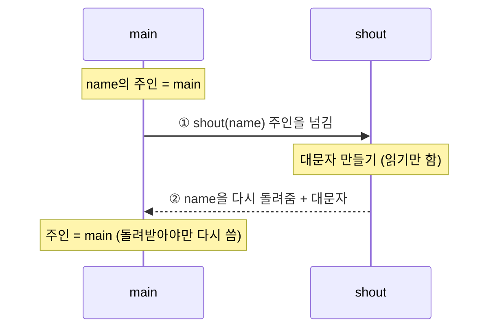
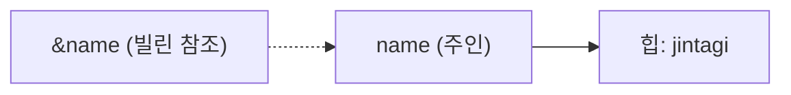
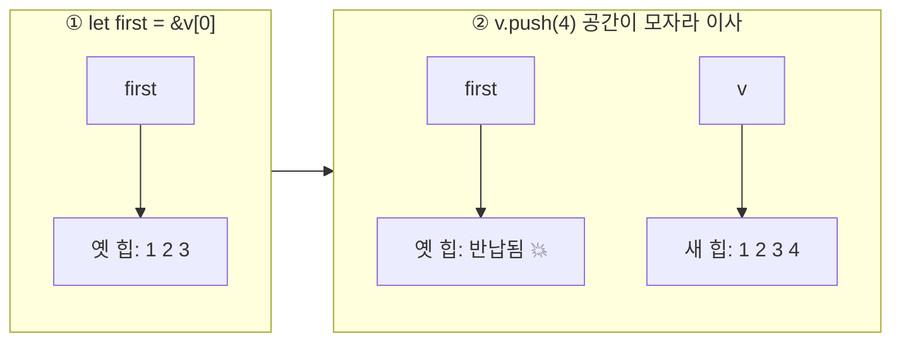

# Lesson 2 · Borrowing: 넘기지 말고 빌려주기

⏱ 약 15분 · 🎯 Lesson 1의 `shout`를 주인을 넘기지 않고 호출하고, `&`/`&mut` 규칙 하나로 `E0502` 에러를 읽고 고친다.

---

## 0. 이 레슨에서 처음 보는 문법

| Rust | 뜻 | TS로 치면 |
|---|---|---|
| `&name` | `name`을 **빌려준다**(읽기 전용 참조). 주인은 그대로 | (없음. TS는 항상 참조가 공유됨) |
| `&String` | "String을 빌린 것" 타입 | `Readonly<...>` 비슷 |
| `let mut n = ...` | **수정 가능한** 변수. `mut` 없으면 수정 불가 | `let` (vs `const`) |
| `&mut n` | **수정 권한까지** 빌려준다 | (없음) |
| `n.push_str("님")` | String 끝에 글자 붙이기 | `n += "님"` |
| `vec![1, 2, 3]` | 길이가 늘어나는 배열(`Vec`) 만들기 | `[1, 2, 3]` |
| `&v[0]` | `v`의 0번 칸을 빌림 | `v[0]` (참조로) |

---

## 1. 복습 (머리로만 답하고 열어보기)

`let t = (1, String::from("hi")); let u = t;` 다음에 `t`를 쓸 수 있을까?

<details><summary>정답</summary>못 쓴다. 튜플 안에 <code>String</code>(힙을 가진 값)이 하나라도 있으면 튜플 전체가 <code>Copy</code>가 아니라서 통째로 move된다. (<a href="./0001-ownership-move.md">Lesson 1 · 4절</a> 표)</details>

---

## 2. Lesson 1의 불편함: 읽기만 하려는데 주인까지 넘긴다



- `shout`는 `name`을 **읽기만** 한다. 그런데 파라미터가 `String`이라 주인이 넘어간다.
- 그래서 Lesson 1 방법 B는 `name`을 튜플에 담아 **일부러 돌려받았다**.
- 책을 읽게 해 주려고 **선물로 줬다가 다시 선물받는** 꼴. 그냥 빌려주면 안 될까?

---

## 3. `&`: 주인은 그대로, 보기만 빌려준다



- `&name` = "name을 가리키는 화살표"를 하나 만들어 빌려주는 것. 이걸 **borrowing**이라 한다.
- 주인은 계속 `name`. 빌린 쪽은 끝나도 **아무것도 치우지 않는다** → double free 걱정 없음.
- 빌린 쪽은 **읽기만** 할 수 있다.

```rust
fn shout(name: &String) -> String {   // &String = String을 빌려서 받는다
    name.to_uppercase()
}

fn main() {
    let name = String::from("jintagi");
    let loud = shout(&name);   // 빌려주기. 주인은 그대로 main
    println!("{loud}");        // JINTAGI
    println!("{name}");        // jintagi ✅ 여전히 쓸 수 있음
}
```

> ⚠️ **TS와 다른 점.** TS에선 객체를 함수에 넘기면 함수가 마음대로 고칠 수 있다. Rust의 `&`는 **고치기 금지**. 고치게 하려면 따로 허락이 필요하다 → `&mut`.

---

## 4. `&mut`: 고칠 권한까지 빌려준다


- 빌려주는 쪽 변수가 `let mut`이어야 한다. 원래 수정 불가인 걸 남에게 고치라고 할 순 없으니까.
- 호출할 때도 `&mut`을 **직접 써야** 한다. 코드만 봐도 "여기서 값이 바뀐다"가 보인다.

```rust
fn add_suffix(name: &mut String) {
    name.push_str("님");
}

fn main() {
    let mut n = String::from("jintagi");   // mut 필수
    add_suffix(&mut n);
    println!("{n}");                        // jintagi님
}
```

`mut`를 빼면: `error[E0596]: cannot borrow 'n' as mutable, as it is not declared as mutable` → `help:`가 `let mut`을 알려준다.

---

## 5. 규칙은 하나: 보기는 여럿, 편집은 혼자

> 어느 시점이든 **`&`는 여러 개** 또는 **`&mut`는 딱 하나**. 둘을 섞을 수 없다.
> ([Book 4.2 · Mutable References](https://doc.rust-lang.org/book/ch04-02-references-and-borrowing.html#mutable-references))

공유 문서로 생각하면 쉽다. `&` = **보기 권한**, `&mut` = **편집 권한**.

| 지금 빌려준 것 | 보기(`&`) 하나 더? | 편집(`&mut`) 하나 더? |
|---|---|---|
| 없음 | ✅ | ✅ |
| 보기 여러 개 | ✅ | ❌ E0502 |
| 편집 하나 | ❌ E0502 | ❌ E0499 |

### 5-1. 왜? 보는 중에 고치면 터지는 실제 버그



- `Vec`은 칸이 모자라면 `push` 때 **더 큰 곳으로 이사하고 옛 공간을 반납**한다.
- 그러면 `first`는 반납된 곳을 가리킨다(**dangling pointer**). 거기엔 이미 다른 데이터가 들어왔을 수도 있다.
- Rust는 "보는 중엔 못 고친다" 규칙으로 이걸 **컴파일 단계에서** 막는다. ([Book 8.1](https://doc.rust-lang.org/book/ch08-01-vectors.html#reading-elements-of-vectors))

```rust
let mut v = vec![1, 2, 3];
let first = &v[0];     // 보기 권한
v.push(4);             // ❌ E0502: 보는 중에 편집
println!("{first}");
```

> 💡 `v.push(4)`엔 `&mut`가 안 보이지만, 값을 고치는 메서드를 부르면 Rust가 **자동으로** `&mut v`를 만든다.
>
> TS에서도 배열을 `for...of`로 돌면서 그 배열에 `push`/`splice`하면 꼬인다. JS는 실행해 봐야 알지만 Rust는 컴파일할 때 알려준다.

### 5-2. "빌려준 상태"는 언제 끝나나: 마지막으로 쓴 줄

빌린 참조는 **만든 줄부터 마지막으로 쓴 줄까지** 살아 있다. `{ }` 블록 끝까지가 아니다.

```text
let r1 = &s;          ─┐ r1 살아 있음 (아래에서 또 쓰니까)
let r2 = &mut s;       │ ❌ 보기 권한이 살아 있는데 편집
r2.push_str("!");      │
println!("{r1}");     ─┘ r1 마지막 사용 → 여기서 끝
```

그래서 **줄 순서만 바꾸면** 통과한다:

```rust
let mut s = String::from("hello");
let r1 = &s;
println!("{r1}");     // r1 마지막 사용 → 보기 끝
let r2 = &mut s;      // ✅ 이제 아무도 안 보고 있음
r2.push_str("!");
println!("{s}");      // hello!
```

### 5-3. E0502 읽는 법

위 ❌ 코드의 rustc 1.95.0 실제 출력:

```
error[E0502]: cannot borrow `s` as mutable because it is also borrowed as immutable
 --> src/main.rs:4:14
  |
3 |     let r1 = &s;
  |              -- immutable borrow occurs here
4 |     let r2 = &mut s;
  |              ^^^^^^ mutable borrow occurs here
5 |     r2.push_str("!");
6 |     println!("{r1}");
  |                -- immutable borrow later used here
```

| 표시 | 뜻 |
|---|---|
| `immutable borrow occurs here` | 보기 권한 **시작** |
| `immutable borrow later used here` | 보기 권한 **끝** (마지막 사용) |
| `mutable borrow occurs here` | 그 사이에 **끼어든 편집** |

고치는 법: **(a)** 마지막 사용 줄을 편집 위로 옮기기 · **(b)** 참조 대신 값 꺼내기(`let first = v[0];` → `i32`는 Copy라 빌린 게 아님) · **(c)** 둘 다 꼭 필요하면 `.clone()`.

---

## 6. 퀴즈 (머리로만 답하고 열어보기)

**Q1.** `shout(&name)` 호출이 끝난 직후 `name`은?
- ⓐ 이동됐다가 돌아와서 다시 쓸 수 있다
- ⓑ 이동한 적이 없어서 그대로 쓸 수 있다
- ⓒ 참조가 해제되면서 함께 drop되어 없다

<details><summary>정답</summary>ⓑ. <code>&</code>는 빌려줄 뿐 주인을 옮기지 않는다. 빌린 쪽은 아무것도 치우지 않는다.</details>

**Q2.** 아래 빈칸 두 곳에 넣었을 때 컴파일되는 것은?

```rust
let mut s = String::from("hi");
let r1 = ___;
let r2 = ___;
println!("{r1} {r2}");   // r1, r2 둘 다 여기까지 살아 있음
```

- ⓐ `&s`, `&s`
- ⓑ `&mut s`, `&mut s`
- ⓒ `&s`, `&mut s`

<details><summary>정답</summary>ⓐ. 보기 권한은 여럿 가능. 편집 권한은 혼자여야 한다 (ⓑ는 E0499, ⓒ는 E0502).</details>

**Q3.** `fn f(v: &String)` 안에서 `v.push_str("x")`를 하면?
- ⓐ 원본 String 끝에 그대로 "x"가 붙는다
- ⓑ 복사본에만 붙고 원본은 변하지 않는다
- ⓒ 읽기 전용 참조라서 컴파일 에러가 난다

<details><summary>정답</summary>ⓒ. <code>&</code>는 보기 권한뿐. 고치려면 시그니처가 <code>&mut String</code>이어야 한다.</details>

---

## 7. 과제 (10분, 직접 타이핑)

**준비** (터미널 아무 위치에서 그대로 붙여넣기)

```sh
cd ~/github/learning/rust-backend && mkdir -p exercises && cd exercises && cargo new rust-02-borrowing && cd rust-02-borrowing
```

코드는 `src/main.rs`, 실행은 이 폴더에서 `cargo run`.

**할 일**

1. Lesson 1의 `shout`를 `&String`을 받도록 고쳐서 아래처럼 출력. 튜플 반환과 `.clone()`은 금지.
   ```
   JINTAGI
   jintagi
   ```
2. `add_suffix(name: &mut String)`를 추가하고 `main`에서 호출해 `jintagi님` 출력.
3. 5-2의 ❌ 코드를 **일부러** 쳐서 E0502를 보고, 에러의 세 표시가 몇 번 줄인지 읽기.
4. **줄 순서만 바꿔서** 통과시키기. 출력은 `hello` 다음 줄 `hello!`.

> 💡 2번과 3번은 다른 변수 이름(`n`, `s`)을 쓰면 한 `main` 안에 같이 둬도 된다.

<details><summary>힌트 (막혔을 때만)</summary>
1: 함수 쪽 <code>name: &String</code>, 호출 쪽 <code>shout(&name)</code>. 둘 다 바꿔야 한다.<br>
2: <code>let mut</code> 잊지 말 것. 호출은 <code>add_suffix(&mut n)</code>.<br>
4: <code>println!("{r1}")</code>을 <code>let r2 = &mut s;</code> 위로.
</details>

다 되면 코드를 `#study_rust`에 올리기 + 한 줄 질문에 네 말로 답하기: **"편집(`&mut`)이 혼자만 허용되는 게 왜 유용할까?"**

---

**🏆 이번 레슨의 승리:** 함수에 값을 넘길 때 **주기**(move) / **보여주기**(`&`) / **고치게 하기**(`&mut`) 중 하나를 고를 수 있다.

**📖 더 읽기:** [The Rust Book · 4.2 References and Borrowing](https://doc.rust-lang.org/book/ch04-02-references-and-borrowing.html) (15분) · 치트시트 [reference/ownership.md](../reference/ownership.md)

> 각주: 실무에선 `&String`보다 `&str`을 더 많이 받는다. 이유는 Lesson 3(slice)에서.

**❓ 막히면** `#study_rust`에서 `@Ferris`.

이전: [Lesson 1 · Ownership](./0001-ownership-move.md) · 다음: [Lesson 3 · Slice와 `&str`](./0003-slices-str.md)
