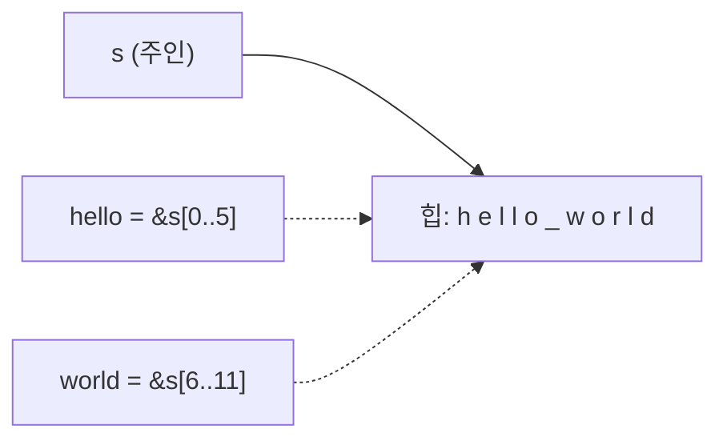
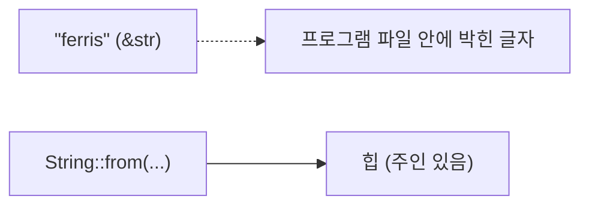
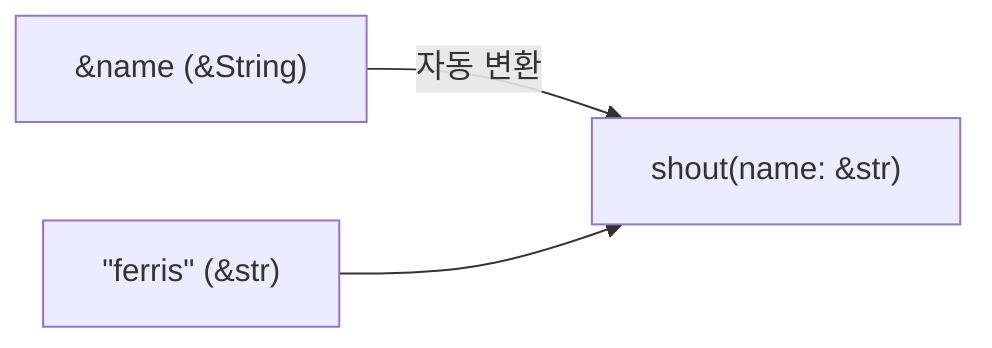

# Lesson 3 · Slice와 `&str`: 문자열의 "일부"를 빌리기

⏱ 약 15분 · 🎯 `"Bearer abc123"` 헤더에서 토큰 부분만 **복사 없이** 잘라 돌려주는 함수를 만들고, 함수 파라미터에 `&String` 대신 `&str`을 쓰는 이유를 말로 설명한다.

> 왜 이걸 배우나: 백엔드는 하루 종일 문자열을 자른다. 요청 헤더, URL 경로, 쿼리 문자열. 매번 새 `String`을 만들면 느리고, 잘라서 **빌려 쓰는** 게 Rust식이다.

---

## 0. 이 레슨에서 처음 보는 문법

| Rust | 뜻 | TS로 치면 |
|---|---|---|
| `&s[0..5]` | `s`의 0번~4번 **바이트**를 빌림 (5는 포함 안 함) | `s.slice(0, 5)` (단, 복사 아님) |
| `&s[7..]` | 7번부터 끝까지 | `s.slice(7)` |
| `&str` | "문자열 조각을 빌린 것" 타입. **string slice** | `string` (읽기 전용) |
| `"ferris"` | 문자열 리터럴. 타입이 `&str` | `"ferris"` |
| `s.len()` | 길이. **바이트 수** | `s.length` (단, UTF-16 단위) |
| `s.clear()` | 내용 전부 지우기 (`&mut` 필요) | `s = ""` |

---

## 1. 복습 (머리로만 답하고 열어보기)

`let first = &v[0]; v.push(4); println!("{first}");`가 컴파일 안 되는 이유를 한 줄로?

<details><summary>정답</summary>보기 권한(<code>first</code>)이 살아 있는 동안 편집(<code>push</code>, 자동으로 <code>&mut v</code>)을 시도해서. E0502. (<a href="./0002-borrowing.md">Lesson 2 · 5-1</a>)</details>

---

## 2. slice: 통째가 아니라 "일부"를 빌린다



- Lesson 2의 `&s`는 String **전체**를 빌렸다. `&s[0..5]`는 **0~4번 칸만** 빌린다.
- 새 문자열을 만들지 않는다. "어디서부터, 몇 칸"만 기억하는 화살표다.
- 이렇게 문자열 일부를 빌린 것의 타입이 **`&str`** (string slice).

```rust
let s = String::from("hello world");
let hello = &s[0..5];    // "hello"
let world = &s[6..11];   // "world"
println!("{hello} / {world}");   // hello / world
```

> ⚠️ **TS와 다른 점.** TS의 `s.slice(0, 5)`는 **새 문자열을 복사**한다. Rust의 `&s[0..5]`는 복사 없이 **원본을 가리킬** 뿐이다. 그래서 빠르지만, 원본이 살아 있어야 한다.
> ([Book 4.3 · String Slices](https://doc.rust-lang.org/book/ch04-03-slices.html#string-slices))

---

## 3. 문자열 리터럴도 `&str`이다



- `"ferris"`라고 쓴 글자는 프로그램 파일 안에 이미 들어 있다. 변수는 그걸 **빌려서 가리킬** 뿐 → 타입이 `&str`.
- `String`은 힙에 내 것을 따로 만든 것. 늘리고 고칠 수 있다.
- 정리: **`String` = 내 거(주인)**, **`&str` = 빌려 본 것**.

---

## 4. 그래서 파라미터는 `&str`로 받는다

Lesson 2의 `shout(name: &String)`에 리터럴을 넣으면?

```rust
fn shout(name: &String) -> String { name.to_uppercase() }
shout("ferris");   // ❌
```

```
error[E0308]: mismatched types
  |     shout("ferris")
  |           ^^^^^^^^ expected `&String`, found `&str`
```

(에러에 `&'static str`이라고도 나오는데, `'static`은 나중에 lifetime에서 배운다. 지금은 `&str`로 읽으면 된다.)

`&str`로 바꾸면 **둘 다** 받는다:



```rust
fn shout(name: &str) -> String {
    name.to_uppercase()
}

fn main() {
    let name = String::from("jintagi");
    println!("{}", shout(&name));     // JINTAGI  ← &String이 &str로 자동 변환
    println!("{}", shout("ferris"));  // FERRIS
}
```

- `&String`은 필요할 때 `&str`로 **자동 변환**된다(deref coercion. 이름만 기억, 원리는 나중에).
- 반대(`&str` → `&String`)는 안 된다.
- 그래서 **읽기만 하는 문자열 파라미터는 `&str`**이 Rust 관례다. Lesson 2 각주의 답이 이것. ([Book 4.3 · String Slices as Parameters](https://doc.rust-lang.org/book/ch04-03-slices.html#string-slices-as-parameters))

---

## 5. 빌린 거니까 Lesson 2 규칙이 그대로 적용된다

```rust
fn token(header: &str) -> &str {
    &header[7..]          // "Bearer " 7글자 뒤부터 끝까지
}

fn main() {
    let mut header = String::from("Bearer abc123");
    let t = token(&header);   // t는 header의 일부를 빌림
    header.clear();           // ❌ E0502: 보는 중에 편집
    println!("{t}");
}
```

```
error[E0502]: cannot borrow `header` as mutable because it is also borrowed as immutable
4 |     let t = token(&header);
  |                   ------- immutable borrow occurs here
5 |     header.clear();
  |     ^^^^^^^^^^^^^^ mutable borrow occurs here
6 |     println!("{t}");
  |                - immutable borrow later used here
```

- `t`는 `header`의 7번 칸 이후를 가리킨다. 그 상태로 `header`를 지우면 `t`는 빈 곳을 가리키게 된다.
- Rust가 컴파일 때 막아준다. 읽는 법은 Lesson 2와 똑같다: 시작 / 끼어든 편집 / 끝.

---

## 6. 함정: 범위는 "글자"가 아니라 "바이트"

| 바이트 번호 | 0 | 1 | 2 | 3 | 4 | 5 |
|---|---|---|---|---|---|---|
| 글자 | 안 | ← | ← | 녕 | ← | ← |
| 자르기 | `&s[0..3]` = "안" | | | `&s[3..6]` = "녕" | | |

- Rust 문자열은 UTF-8. 영어는 1글자 = 1바이트지만 **한글은 1글자 = 3바이트**.
- `"안녕".len()`은 `2`가 아니라 **`6`**. `&s[0..3]`이 `"안"`.
- 글자 중간을 자르면 **실행 중에 panic**(프로그램이 멈춤):

```rust
let s = String::from("안녕");
let first = &s[0..1];   // 컴파일은 됨. 실행하면 panic
```

```
thread 'main' panicked at src/main.rs:3:19:
end byte index 1 is not a char boundary; it is inside '안' (bytes 0..3) of `안녕`
```

> 컴파일러가 못 잡는 몇 안 되는 경우다. 한글을 다룰 땐 숫자로 자르지 말 것. 안전한 방법(`chars()` 등)은 문자열을 본격적으로 다루는 [Book 8.2](https://doc.rust-lang.org/book/ch08-02-strings.html#slicing-strings)에서. 지금은 "**ASCII(영어·숫자·기호)일 때만 숫자로 자른다**"만 기억.

---

## 7. 퀴즈 (머리로만 답하고 열어보기)

**Q1.** `let w = &s[6..11];`을 실행하면 메모리에서 무슨 일이?
- ⓐ 6~10번 바이트를 새 힙 공간에 복사한다
- ⓑ 6~10번 바이트를 원본에서 가리키기만 한다
- ⓒ 원본 s에서 6~10번 바이트를 잘라서 뺀다

<details><summary>정답</summary>ⓑ. slice는 복사도 변경도 아닌 "원본의 일부를 빌린 화살표"다.</details>

**Q2.** 문자열을 읽기만 하는 함수의 파라미터로 가장 알맞은 타입은?
- ⓐ `String`
- ⓑ `&String`
- ⓒ `&str`

<details><summary>정답</summary>ⓒ. <code>&String</code>도 <code>&str</code>로 자동 변환돼 들어오고, 리터럴도 받을 수 있다. ⓐ는 주인을 넘겨 버리고, ⓑ는 리터럴을 못 받는다.</details>

**Q3.** `"가나다".len()`의 값은?
- ⓐ `3`
- ⓑ `6`
- ⓒ `9`

<details><summary>정답</summary>ⓒ. 한글 1글자 = UTF-8로 3바이트. <code>len()</code>은 바이트 수.</details>

---

## 8. 과제 (10분, 직접 타이핑)

**준비** (터미널 아무 위치에서 그대로 붙여넣기)

```sh
cd ~/github/learning/rust-backend && mkdir -p exercises && cd exercises && cargo new rust-03-slices && cd rust-03-slices
```

**할 일**

1. `fn token(header: &str) -> &str`를 만들어 `"Bearer abc123"`에서 `abc123`만 돌려주기. `String::from`이나 `.to_string()`으로 **새 문자열을 만들면 안 됨**.
2. `fn shout(name: &str) -> String`을 만들어 `String` 변수와 리터럴 **둘 다** 넣어 보기. 출력:
   ```
   abc123
   JINTAGI
   FERRIS
   ```
3. 5절의 ❌ 코드(`header.clear()`)를 **일부러** 쳐서 E0502를 보고, **줄 순서만 바꿔서** 통과시키기.
4. (보너스) 6절의 `"안녕"` 코드를 실행해서 panic 메시지를 직접 읽어 보기.

<details><summary>힌트 (막혔을 때만)</summary>
1: <code>"Bearer "</code>는 공백까지 7바이트. <code>&header[7..]</code>.<br>
2: 호출은 <code>shout(&name)</code>, <code>shout("ferris")</code>.<br>
3: <code>println!("{t}")</code>을 <code>header.clear()</code> 위로.
</details>

다 되면 코드를 `#study_rust`에 올리기 + 한 줄 질문에 네 말로 답하기: **"`token`이 새 String 대신 `&str`을 돌려주면 뭐가 좋을까?"**

---

**🏆 이번 레슨의 승리:** 문자열을 복사하지 않고 **잘라서 빌려줄** 수 있고, 함수 파라미터에 `&str`을 고를 수 있다.

**📖 더 읽기:** [The Rust Book · 4.3 The Slice Type](https://doc.rust-lang.org/book/ch04-03-slices.html) (15분) · 치트시트 [reference/ownership.md](../reference/ownership.md)

**❓ 막히면** `#study_rust`에서 `@Ferris`.

이전: [Lesson 2 · Borrowing](./0002-borrowing.md) · 다음: Lesson 4 · struct (데이터 묶기)
